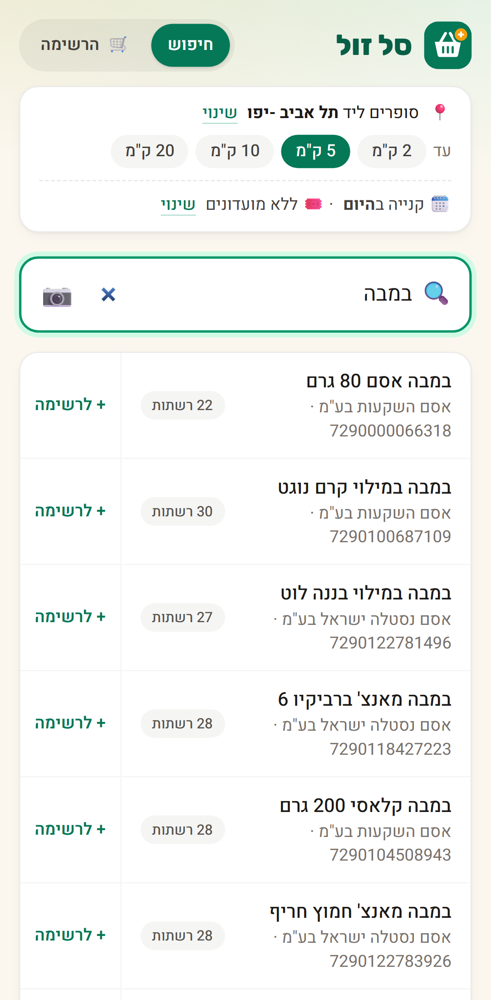
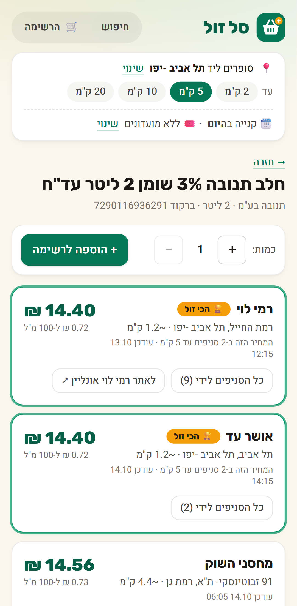
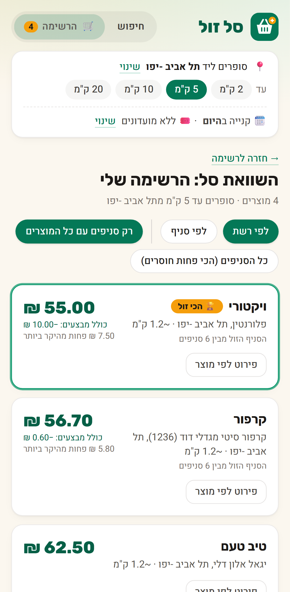
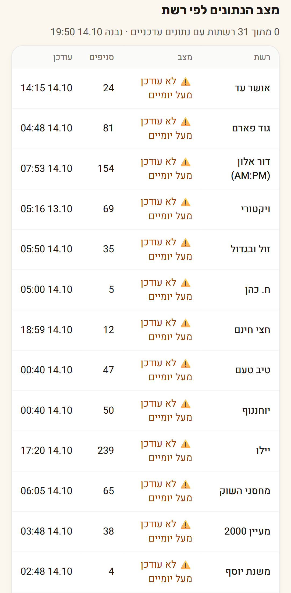

# סל זול (SalZol)

**Where is it cheapest to shop near me?** SalZol compares supermarket prices across Israeli chains, using
the price files every large chain must publish under the Food Act (price transparency).

**Live:** https://alon24g.github.io/salzol/ (Hebrew, mobile first, installable, works offline)

| Home | Search | Product | Basket | About |
|---|---|---|---|---|
|  |  |  |  |  |

## What it does

- **Search** about 214,000 products from 30 chains by name (Hebrew, typo- and final-letter tolerant)
  or by barcode, or **scan a barcode** with the camera.
- **Product page:** the cheapest store of each chain near you (2/5/10/20 km, by GPS or city), with
  promotions applied: club deals, "N for ₪X", 1+1, weekday deals. Also shows the regular price, unit
  price, and when each chain last updated.
- **Shopping lists:** several named lists, quantities, and a **basket comparison** by chain or by store
  ("only stores with everything" or "fewest missing"). Lists can be shared by link or exported to a file.
- **Installable PWA:** pages and prices you have seen keep working without a connection, so a list
  made at home can be compared in the store.
- **About page:** data freshness for every chain (fresh, more than 48 h old, or no data).

No backend and no cost: a scheduled GitHub Actions pipeline turns the chains' XML files into static
JSON, and GitHub Pages serves it next to the React app.

## How it works

```
chain portals ──▶ pipeline/fetch.py ──▶ raw XML ──▶ pipeline/build.py ──▶ dist/data/*.json ──▶ GitHub Pages
                  (il-supermarket-scraper)           normalize, geocode,        meta, stores, cities,
                                                     promos, shard              search index, price shards,
                                                                                promo chunks
```

- `.github/workflows/pipeline.yml` runs 3 times a day. It fetches 25 chains in 5 parallel groups on
  GitHub-hosted runners, builds, and deploys (about 50 minutes).
- Five chains block non-Israeli IPs (Victory, Hazi Hinam, H. Cohen, Mahsanei HaShuk, Super-Pharm).
  `.github/workflows/fetch-israel.yml` fetches them on a **self-hosted runner in Israel** (a home PC).
  The pipeline never waits for it: for each of these chains it uses the newest artifact from the last
  48 h. See [docs/self-hosted-runner.md](docs/self-hosted-runner.md).
- If a chain's fetch gets no price files (a portal timing out), the build keeps that chain's data
  from the newest earlier run of the last 48 h (`.github/scripts/reuse-previous-raw.sh`). The About
  page shows its real age.
- The app ([web/](web/)) loads only what a page needs:
  - a 5 MB (gzipped) search index, built in a Web Worker on first search;
  - one of 1,024 price shards (~24 KB each) per product;
  - only the promotion chunks that product references.

  Data files are versioned by build time. The service worker keeps them for offline use and drops
  them once a newer build is published.

Milestone reports with the details and decisions: [M0](docs/m0-reachability.md), [M1](docs/m1-report.md),
[M3](docs/m3-report.md), [M4](docs/m4-report.md), [M5](docs/m5-report.md), [M6](docs/m6-report.md).

## Setup

You need Python 3.12+ and Node 24.

### Pipeline (data)

```sh
python -m venv .venv
.venv/bin/pip install -r requirements.txt -r requirements-dev.txt        # Windows: .venv\Scripts\...

# Fetch a few chains (names from il-supermarket-scraper's ScraperFactory) into raw/
.venv/bin/python -m pipeline.fetch --out raw --chains SHUFERSAL,RAMI_LEVY --kinds stores,price_full,promo_full

# Build the site data into dist/data/
.venv/bin/python -m pipeline.build --raw raw --out dist/data

.venv/bin/python -m pytest -q pipeline/tests
```

All 31 chains take about 25 minutes to fetch and 15 minutes to build, with about 1.5 GB RAM at peak.
On Windows the scraper runs natively: `pipeline/fetch.py` shims `fcntl`. Set `PYTHONUTF8=1` for
readable Hebrew in the console.

### Web app

```sh
cd web
npm ci
npm run dev                     # http://localhost:5173/salzol/, serves ../dist/data
npm run build && npx vite preview --port 4180
```

`DATA_DIR=/path/to/data` points the dev and preview servers at another data folder.

### Tests

```sh
cd web
npx tsc -b && npx oxlint        # types, lint
npx vitest run                  # unit: search, promotions, baskets, lists, distances
npx playwright install chromium
npx playwright test             # end-to-end, on a frozen real-data snapshot (tests/e2e/fixtures/data)
```

The Playwright suite uses page objects (`tests/e2e/pages.ts`), `data-testid` selectors and no fixed
waits. The browser clock is frozen to the snapshot's date, so promotion windows stay valid. It covers:

- search, the product page, location and radius;
- promotions and club membership;
- lists, basket comparison, sharing and export;
- installability and offline use (including comparing a list offline);
- barcode scanning through Chromium's fake camera: once with `BarcodeDetector` stubbed, and once in
  the `scanner-zxing` project, where ZXing decodes a generated EAN-13 video frame.

CI (`.github/workflows/ci.yml`) runs all of this on every push and pull request.

## Deploying your own copy

1. Fork the repo and enable **Pages → Source: GitHub Actions**.
2. If the site's path isn't `/salzol/`, set `BASE_PATH` for the build in `pipeline.yml`.
3. Run **Actions → Pipeline → Run workflow**. Scheduled runs follow.
4. Optional: chains that block foreign IPs need a self-hosted runner in Israel with the label `israel`
   ([docs/self-hosted-runner.md](docs/self-hosted-runner.md)). Without one, those chains show as
   "no data" and everything else works.

## Limitations

- Prices come from the chains' files. The shelf price can differ, and personal coupons are not
  included.
- Store distances are measured from the store's city center (the files have no coordinates).
- Eilat stores (VAT-exempt) and online-only stores are excluded.
- Netiv HaHesed's portal has been returning HTTP 500, so it has no data.

Data collection uses [israeli-supermarket-scrapers](https://github.com/OpenIsraeliSupermarkets/israeli-supermarket-scarpers).
